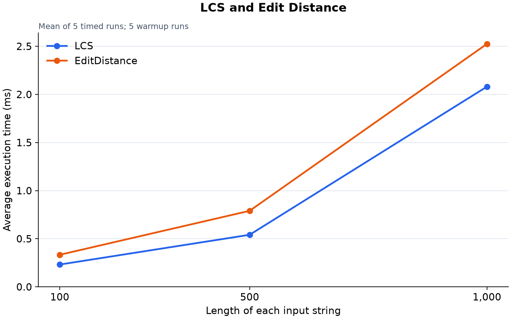
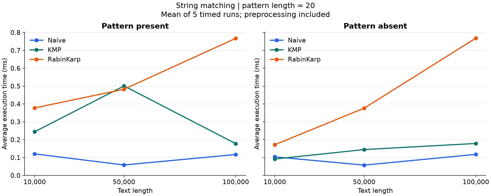
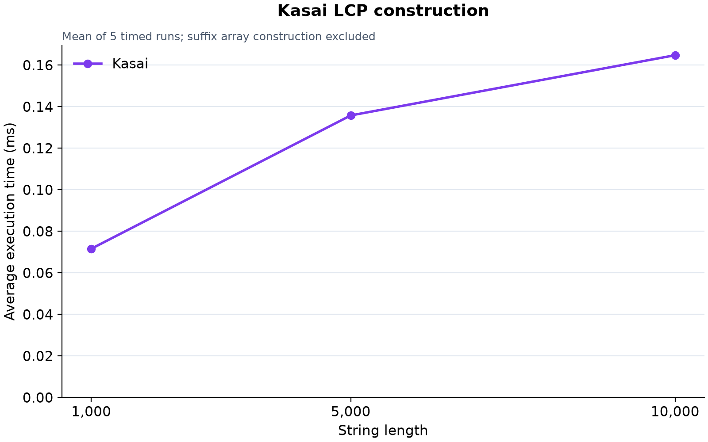

# Assignment 4: Text Analysis

## 1. Overview

This project implements six text-analysis algorithms in Java:

- **LCS:** finds the length of the longest common subsequence.
- **Edit Distance:** finds the minimum number of insertions, deletions and substitutions.
- **Naive matching:** checks the pattern at every possible position.
- **KMP:** uses an LPS table to reuse matched-prefix information.
- **Rabin-Karp:** searches using a rolling hash and verifies matching candidates.
- **Kasai:** builds the LCP array from a string and its suffix array.

## 2. Project structure

| File or folder | Purpose |
| --- | --- |
| `src/Main.java` | Demonstration |
| `src/LCS.java` | Longest Common Subsequence |
| `src/EditDistance.java` | Levenshtein distance |
| `src/SearchResult.java` | Positions and comparison count |
| `src/StringMatching.java` | Naive, KMP and Rabin-Karp |
| `src/Kasai.java` | LCP construction |
| `src/SuffixArray.java` | Suffix-array helper |
| `src/AlgorithmTests.java` | Correctness tests |
| `src/Benchmark.java` | Timing experiments |
| `results/` | CSV results and environment information |
| `plots/` | Experimental graphs |
| `plot_results.py` | Generates graphs |

The Java application uses standard libraries and the default package.

### Assumptions

- Inputs must not be `null`; empty strings are supported.
- Matching is case-sensitive and returns zero-based indices.
- Overlapping occurrences are included.
- An empty pattern matches all `n + 1` text boundaries.
- A pattern longer than the text returns an empty list.
- Indices use Java UTF-16 character units.
- Each insertion, deletion and substitution costs 1.

## 3. Algorithms and correctness

### LCS

`dp[i][j]` stores the LCS length for prefixes of lengths `i` and `j`.

```text
dp[0][j] = dp[i][0] = 0

If A[i - 1] == B[j - 1]:
    dp[i][j] = dp[i - 1][j - 1] + 1
Otherwise:
    dp[i][j] = max(dp[i - 1][j], dp[i][j - 1])
```

Matching last characters can extend an optimal solution for shorter prefixes. If they differ, at least one must be skipped. Taking the maximum covers both choices.

Example: `abcde` and `ace` have LCS length 3.

### Edit Distance

`dp[i][j]` stores the minimum edit cost between prefixes.

```text
dp[i][0] = i
dp[0][j] = j

cost = 0 if A[i - 1] == B[j - 1], otherwise 1

dp[i][j] = min(
    dp[i - 1][j] + 1,
    dp[i][j - 1] + 1,
    dp[i - 1][j - 1] + cost
)
```

The options represent deletion, insertion and substitution or a match. Every possible final operation leaves a smaller prefix problem, so choosing the minimum gives the optimal cost.

Both DP tables are filled after their required smaller states.

Example: the distance between `kitten` and `sitting` is 3.

### String matching

**Naive** compares characters at every possible starting position.

**KMP** builds `lps[i]`, the longest proper prefix of `pattern[0..i]` that is also its suffix. After a mismatch, it uses `j = lps[j - 1]`. The text index never moves backwards. The same fallback after a full match preserves overlapping occurrences.

**Rabin-Karp** uses base 31 and modulus 1,000,000,007. It removes the outgoing character and adds the incoming character to update each window hash in O(1). Equal hashes are verified character by character to handle collisions. The test using `bB` and `aa` checks a real collision.

All three methods return `[0, 3, 6]` when searching for `abc` in `abcabcabc`.

### Kasai

This project defines:

```text
lcp[0] = 0
lcp[i] = LCP(sa[i - 1], sa[i])
```

Each value describes the common prefix of neighbouring suffixes in sorted order.

Manually verified example:

```text
String: banana$
Sorted suffixes: $, a$, ana$, anana$, banana$, na$, nana$

Suffix array: [6, 5, 3, 1, 0, 4, 2]
LCP array:    [0, 0, 1, 3, 0, 0, 2]
```

Kasai builds an inverse rank array and visits suffixes in text order. It reuses the previous common-prefix length minus one. The total increases and decreases of this length are linear, giving O(n) time.

The method validates suffix indices but assumes correct lexicographic order.

The suffix-array helper sorts indices using direct character comparisons. Its worst-case time is O(n² log n), and its auxiliary space is O(n). Its construction is excluded from Kasai timing.

## 4. Complexity analysis

For DP, `n` and `m` are the string lengths. For matching, they are the text and pattern lengths. Matching bounds assume `1 <= m <= n`. Auxiliary space excludes returned results.

| Algorithm | Main operation | Preprocessing | Best time | Worst time | Auxiliary space |
| --- | --- | --- | --- | --- | --- |
| LCS | Diagonal + 1 or maximum of adjacent states | Table allocation | Θ(nm) | Θ(nm) | O(nm) |
| Edit Distance | Minimum of three edit choices | Allocation and base cases | Θ(nm) | Θ(nm) | O(nm) |
| Naive | Compare at every offset | O(1) | Θ(n − m + 1) search | Θ((n − m + 1)m) search | O(1) |
| KMP | LPS and prefix fallbacks | Θ(m) | Θ(n + m) total | Θ(n + m) total | O(m) |
| Rabin-Karp | Rolling hash and verification | Θ(m) | Θ(n + m) total | O(nm) total | O(1) |
| Kasai | Rank and reused prefix length | Θ(n) for rank | Θ(n) total | Θ(n) total | O(n) |

DP processes every table cell with constant work. The exact table size is `(n + 1)(m + 1)`, including empty-input cases.

Naive can fail immediately or compare all pattern characters at each offset. KMP search takes Θ(n), with amortized linear fallback work.

Rabin-Karp has expected O(n + m) time on random inputs with few matches and rare collisions. Verification can produce O(nm) time when there are many actual matches or collisions. More explicitly, its upper bound is O(n + m + (z + c)m), where `z` is the number of matches and `c` the false hash candidates.

Matching output takes O(z) space. An empty pattern takes O(n) time and output space.

## 5. Testing

Tests cover:

| Algorithm | Main cases |
| --- | --- |
| LCS | Identical, different, empty strings and known subsequences |
| Edit Distance | Identical, empty strings, insertion, deletion, substitution and mixed edits |
| Matching | Beginning, middle, end, multiple/overlapping matches, absent/long/empty patterns, empty text and collision |
| Kasai | Manually checked banana$, empty, single and repeated characters |

There are also 100 random matching cases and 100 random Kasai cases.

Every matching test checks expected positions and agreement between all three methods. Random matching uses Naive as a reference. Random Kasai results are compared with direct adjacent-suffix comparisons.

Observed output:

```text
ALL TESTS PASSED: 572 checks
```

The tests use explicit checks and do not require JUnit or `-ea`.

## 6. Experimental methodology

| Setting | Value |
| --- | --- |
| Environment | Java 25.0.1, Mac OS X, aarch64 |
| Available processors reported by Java | 10 |
| Random seed | 42 |
| Alphabet | abcdefghijklmnopqrstuvwxyz |
| Warmup / timed runs | 5 / 5 per experiment |
| Timer | System.nanoTime() |
| DP sizes | Two strings of length 100, 500 and 1,000 |
| Matching text sizes | 10,000, 50,000 and 100,000 |
| Pattern length | 20 |
| Kasai sizes | 1,000, 5,000 and 10,000 |

LCS and Edit Distance receive the same string pairs. All matching algorithms receive the same text and pattern for each comparison.

Present patterns are taken from the text. Absent patterns use the same alphabet and are checked before timing.

The average is the total elapsed time divided by five. Input generation, console output and file operations are outside timed regions. Algorithm allocations and counters are included.

KMP timing includes LPS construction. Rabin-Karp includes hash preparation. Kasai includes rank construction and validation, but excludes suffix-array sorting.

Character counts come from an additional untimed call. KMP includes LPS comparisons; Rabin-Karp counts candidate verification only. Hash operations are not counted.

CSV values are in nanoseconds. Report values are in milliseconds, rounded to six decimal places.

## 7. Results

### Dynamic programming

| String length | LCS (ms) | Edit Distance (ms) |
| --- | --- | --- |
| 100 | 0.231900 | 0.333283 |
| 500 | 0.541016 | 0.790158 |
| 1,000 | 2.080933 | 2.525033 |



### String matching

| Text length | Case | Naive (ms) | KMP (ms) | Rabin-Karp (ms) |
| --- | --- | --- | --- | --- |
| 10,000 | present | 0.120392 | 0.244408 | 0.377741 |
| 10,000 | absent | 0.103942 | 0.091792 | 0.171750 |
| 50,000 | present | 0.058508 | 0.500708 | 0.482300 |
| 50,000 | absent | 0.057675 | 0.144742 | 0.376508 |
| 100,000 | present | 0.117125 | 0.177792 | 0.767267 |
| 100,000 | absent | 0.117783 | 0.178850 | 0.768325 |



### Character comparisons

| Text length | Case | Naive | KMP | Rabin-Karp | Matches per method |
| --- | --- | --- | --- | --- | --- |
| 10,000 | present | 10,388 | 10,390 | 20 | 1 |
| 10,000 | absent | 10,400 | 10,419 | 0 | 0 |
| 50,000 | present | 52,067 | 52,027 | 20 | 1 |
| 50,000 | absent | 52,029 | 51,990 | 0 | 0 |
| 100,000 | present | 104,032 | 103,894 | 20 | 1 |
| 100,000 | absent | 104,058 | 103,944 | 0 | 0 |

### Kasai

| String length | Time (ms) |
| --- | --- |
| 1,000 | 0.071592 |
| 5,000 | 0.135792 |
| 10,000 | 0.164784 |



## 8. Discussion and conclusion

**DP:** from length 500 to 1,000, LCS time grows about 3.85 times and Edit Distance about 3.20 times. The number of cells grows four times, so these measurements are broadly consistent with quadratic growth. Edit Distance is slower at every tested size in this run.

**Naive and KMP:** random text usually causes early mismatches. Naive therefore makes approximately n comparisons and is faster at the two larger sizes. These inputs provide little benefit from KMP's prefix reuse. This does not change KMP's better worst-case guarantee.

**Rabin-Karp:** few character comparisons do not mean little total work. The method still updates and compares hashes throughout the text. At length 100,000, it takes about 0.767 ms for the present pattern and 0.768 ms for the absent pattern.

**Timing limitations:** some larger inputs run faster than smaller ones. Present-pattern KMP takes about 0.501 ms at 50,000 and 0.178 ms at 100,000. JVM warmup and measurement noise are possible explanations, but the saved averages do not identify the exact cause. Five warmup calls may be insufficient. Individual timings were not saved.

**Kasai:** execution time increases with input size, but not proportionally in this small run. Its O(n) bound follows from the amortized analysis, not from these three points alone.

The graphs connect measured points and do not prove complexity bounds. Fixed-length patterns and random text also do not demonstrate matching worst cases.

Overall, DP is clear but uses O(nm) memory. Naive is simple, KMP offers predictable linear total time, Rabin-Karp trades direct comparisons for hashing, and Kasai efficiently builds LCP when a suffix array is available.

## 9. Running the project

From the project root:

```bash
javac --release 17 -d out src/*.java
java -cp out Main
java -cp out AlgorithmTests
java -cp out Benchmark
```

These commands also work with JDK 25. In IntelliJ IDEA, run the same three classes with the project root as the working directory.

To generate graphs on macOS:

```bash
python3 -m venv .venv
source .venv/bin/activate
python3 -m pip install matplotlib
python3 plot_results.py
```

Python is only needed for plotting. Keep `plots/` next to `README.md`.

If the benchmark is run again, timings may change. Update the tables, graphs and discussion together.

## 10. Submission

Submit the GitHub repository link through Moodle. The repository contains source code, tests, results, graphs and this README report.

A separate PDF report is not required.